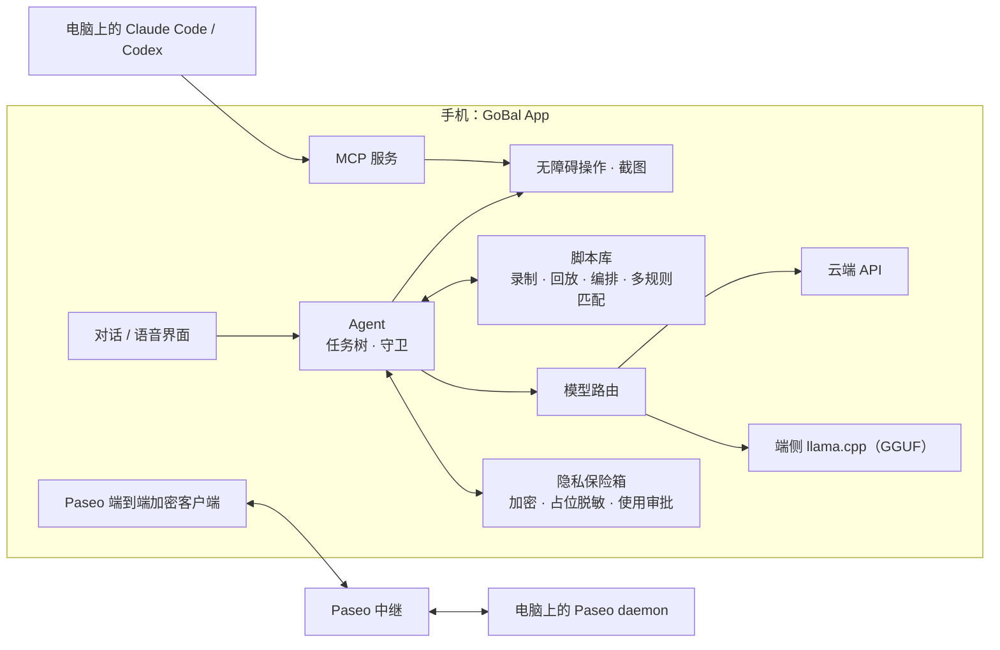

<p align="center"></p>

<h1 align="center">GoBal（狗宝）</h1>

<p align="center">
  免 root 的安卓手机 GUI Agent：说一句话，它替你在手机上把事办完。
</p>

<p align="center">
  <a href="https://github.com/4ward2/GoBal/actions/workflows/ci.yml"></a>
  <a href="LICENSE.md"></a>
  
</p>

<p align="center"><b>中文</b> · <a href="#english">English</a></p>

---

## 为什么做狗宝

狗宝想做的事和 [Meta Muse](https://about.fb.com/news/2026/09/introducing-muse) 一样：**你说一句话，它替你把事办完。** 不同的是，狗宝主打**科技平权、人文关怀**：

- **跑在你自己的手机上。** 不需要电脑、不需要 ADB 连线，也不需要把任务交给云端虚拟机；它直接操作你手机里的真实 App，包括只在国内提供的 App。
- **面向各年龄群体，尤其照顾不会用手机的人。** 中老年人、不识字的用户只要开口说话，狗宝就能替他们点按、输入、跑完流程；熟练的人也能把重复操作交给它。
- **模型由你决定。** 可以接任意云端大模型，也可以把模型下载到手机里完全离线运行。
- **私密信息不交给 AI。** 电话、地址等存在加密保险箱，Agent 只看到占位符；付款、验证码、登录始终由本人完成。
- **完全开源。** MIT 许可，代码、数据流和权限都可以审计。

## 它能做什么

**手机 Agent**
- 读懂当前界面并操作任意 App：点击、输入、滑动、返回、切换应用。
- 长任务用**树状上下文**管理：把大任务拆成子任务逐个推进，搜索型任务会记录已经看过的分支，避免原地打转或编造结果。
- 内置守卫：遇到付款下单、验证码和登录会停下来交给你本人处理；只操作你在设置里授权过的 App。

**脚本：越用越快**
- Agent 成功完成过的操作，会被**固化成脚本**；同类任务再来时直接回放，不必每一步都问模型。
- 也可以**人工录制**：在手机上演示一遍，狗宝记下每一步，之后可以回放、修改、拼接编排。
- 回放时按**多种规则匹配**目标：文字、OCR 识别结果、图像特征、屏幕签名，界面小改版也能找到对的按钮。

**模型：端侧和云端都能用**
- 云端预置 OpenAI、Anthropic、DeepSeek、Gemini、通义千问、智谱、Kimi、硅基流动、OpenRouter，也可以填任意 OpenAI 兼容接口。
- 端侧内嵌 llama.cpp，可在手机上直接下载、运行 GGUF 模型，完全离线工作。

**对话、语音与记忆**
- 手机端自带对话界面，会话本地保存，可编辑、导出、带附件。
- 通话式语音交互：本地语音识别、语音合成、回声抑制，可以像打电话一样跟狗宝说话。
- 记忆库：可以导入文档和图片（含 OCR），让 Agent 记住你的偏好和常用信息。

**隐私保险箱**
- 手机号、地址、证件号、密码等私密信息存在本机加密保险箱里；Agent 只看到 `‹vault:槽位›` 这样的占位符，真实内容不会发给模型。
- 什么信息能填进哪个输入框，由本地规则决定，不由模型决定；填进其他 App 前会在手机上请你批准。详见下文“本地安全与隐私”。

**不依赖大模型的规则助手**

这些功能完全按固定规则在手机上运行，不调用任何大模型，数据不出手机：

- **一句话存入私密信息**：说或输入「手机号 幺三八 一二三四 五六七八」「我的身份证号是……」，狗宝用关键词词典判断是哪一项、用口语数字规则读出号码（支持中文数字、“幺”、中英文和印地语），再做格式校验（手机号长度、身份证校验位等），给你看一眼确认后再加密保存。
- **一句话配置模型**：从一句话里按 API Key 的格式认出密钥和对应的服务商，弹出确认卡片补全其余设置。
- **验证码自动填入**：从短信和通知里按规则提取验证码，自动跳过有效期、金额、日期和“尾号 1234”这类干扰数字，填进当前的验证码输入框，单格输入框也能逐位填写。
- **开屏广告跳过**：App 启动后的几秒内自动找到并点掉“跳过”按钮。
- **本地语音识别**：内置 sherpa-onnx 中文流式识别模型（约 25 MB，下载一次），之后无需联网，也不依赖手机厂商的识别服务。

**和电脑上的 Agent 联动**
- 狗宝同时是一个 **MCP 服务**：电脑上的 Claude Code、Codex 等可以通过 MCP 直接操控这台手机。
- 实现了 [Paseo](https://github.com/getpaseo/paseo) 协议的**端到端加密客户端**：扫码配对后，在手机上就能查看和指挥电脑上的编程 Agent。
- 支持 Cloudflare Tunnel / ngrok 隧道，手机不在同一局域网也能连。

**个性化**
- 角色卡：给狗宝换个性格和说话风格。

## 和同类产品比较

下表依据各项目 2026 年 10 月的公开资料整理，如有出入以各项目官方说明为准。“未说明”表示官方资料没有提到。

| 产品 | 形态与开源 | 在哪里执行 | 模型 | 手机端离线 | 私密信息 | 操作复用 |
|---|---|---|---|---|---|---|
| **狗宝 GoBal** | 手机 App，MIT | 手机本机，免 root，读无障碍树操作真实 App，不需要电脑 | 9 家云端预置、任意 OpenAI 兼容接口、端侧 GGUF | 支持（llama.cpp） | Keystore 加密保险箱，Agent 只见占位符；本地规则决定能否填写，写入需审批；私密信息可用纯规则录入，不经模型 | 成功操作自动固化为脚本；可人工录制、回放、编排；多规则匹配 |
| [豆包手机](https://tech.ifeng.com/c/8xDQi6fLfER) | 系统级助手，闭源 | 预装于努比亚 M153、NaviX Ultra，系统级权限 | 豆包自有 | 未说明 | 第三方 App 可按 SAEP 协议拒绝被操作，据报道微信、QQ、淘宝、支付宝、美团等在拒绝名单 | 未说明 |
| [Meta Muse](https://about.fb.com/news/2026/09/introducing-muse) | 云端个人智能体，闭源 | 云端安全虚拟机里的浏览器；手机 App 只是入口，仅限美国 | Meta 自有 | 不支持 | 称 Agent 看不到密码和支付信息，一次性卡号付款 | 未说明 |
| [nanoMuse](https://github.com/nano-muse/nanoMuse)（浙江大学） | 多端个人智能体，GPL-3.0 | 手机本机运行 Agent，优先用 API 和技能，屏幕操作为最后手段，逐步截屏；跨设备同步需中继 | 任意 OpenAI 兼容接口（约 25 家） | 未提供 | 审批守门与数据流向追踪；密码、验证码由本人输入 | 支持技能；操作轨迹可回看，不能回放 |
| [Open-AutoGLM](https://github.com/zai-org/Open-AutoGLM)（智谱） | 框架，Apache-2.0 | 电脑经 ADB / HDC 控制手机 | AutoGLM-Phone-9B，OpenAI 兼容接口 | 需自建 GPU 服务器 | 敏感操作确认，登录和验证码人工接管 | 未说明 |
| [DroidRun](https://github.com/droidrun/droidrun) | 框架，MIT | 电脑经 ADB + Portal App 控制手机（或其云服务） | 多家云端，含 Ollama | 未说明 | 未说明 | 可回放宏 |
| [Mobile-Agent](https://github.com/X-PLUG/MobileAgent)（阿里） | 研究框架，MIT | 自建部署或云手机 | GUI-Owl 系列 | 需自建推理服务 | 未说明 | 未说明 |
| [UI-TARS](https://github.com/bytedance/UI-TARS)（字节） | 视觉语言模型，Apache-2.0 | 需自行部署推理服务，无安卓端 App | UI-TARS 自身 | 需自建推理服务 | — | — |

狗宝的定位，是把“能办事的 Agent”直接装进每个人自己的手机：不挑机型，不依赖电脑和云端虚拟机，也不绑定某一家的模型。和所有通过屏幕或无障碍操作 App 的方案一样，个别 App 可能会限制自动化操作，这类步骤狗宝会交还给你本人完成。

## 架构一览



## 快速开始

### 安装

正式安装包会发布在 [Releases](https://github.com/4ward2/GoBal/releases)。在那之前，请按下面的步骤从源码构建。

系统要求：Android 10（API 29）及以上。

### 从源码构建

```bash
git clone --recurse-submodules https://github.com/4ward2/GoBal.git
cd GoBal
python scripts/fetch_sherpa_onnx.py   # 下载并校验固定版本的语音运行时
./gradlew assembleDebug
```

- 需要 **JDK 17** 和 Android SDK；隧道相关的原生依赖见 [CONTRIBUTING.md](CONTRIBUTING.md)。
- 中英文 OCR 数据已经包含在仓库里。所有第三方组件的来源、SHA-256 和许可证见 [THIRD_PARTY_LICENSES.md](THIRD_PARTY_LICENSES.md)。
- 无线 ADB 配对还需要 `libadbpairing.so`，用 [scripts/build-adb-pairing.sh](scripts/build-adb-pairing.sh) 配合 Android NDK 构建；生成的 JNI 库不进仓库。
- 签名请使用你自己的 keystore，模板见 `keystore.properties.example`。

### 第一次使用

1. 打开狗宝，按提示开启**无障碍服务**和**屏幕截取**权限（每项权限的用途见 [docs/PERMISSIONS.md](docs/PERMISSIONS.md)）。
2. 在设置里选择模型：填入任一云端服务的 API Key，或者下载一个端侧 GGUF 模型。
3. 在对话框里说出你的需求，比如“帮我看看今天的快递到哪了”。

### 让电脑上的 Agent 控制手机

- **MCP**：在狗宝里打开 MCP 服务，把显示的地址和令牌填进 Claude Code / Codex 的 MCP 配置。工具清单见 [docs/MCP_TOOLS.md](docs/MCP_TOOLS.md)。
- **Paseo**：在电脑上运行 Paseo，用狗宝扫描配对二维码，即可通过加密中继互联。

## 本地安全与隐私

狗宝能看到并操作你手机上的界面，所以安全设计默认“不信任模型”：模型负责理解和规划，能不能动私密信息、能不能付钱，由手机本地的规则和你本人决定。

**加密存储**
- 保险箱使用 AES-256-GCM 加密，密钥由 Android Keystore 生成且不可导出（设备有 StrongBox 时用 StrongBox，否则用 TEE）。密钥从不出现在 App 进程内存里，把保险箱文件拷出手机也无法解密；文件被篡改会被检测出来。
- 普通信息和密码类信息分开存放：密码类单独加密，用时才解密、不缓存，只在写入密码框的那一刻存在于内存中。
- 写入采用原子替换并先落盘，断电不会留下损坏的半截文件。
- 远程电脑的配对密钥、无线 ADB 身份也用 Keystore 中的密钥加密保存。

**发给模型之前先脱敏**
- 屏幕文字、工具返回结果在交给模型前，会把其中出现的保险箱内容替换成占位符。匹配考虑了 App 的各种显示格式：号码中间的空格、横线、括号、全角空格，可省略的 `+86`，以及 JSON 转义；两三个字的中文姓名也能覆盖。

**填写由规则把关**
- 只能填进真实可用的输入框，不能填进狗宝自己的聊天界面（那里的内容会直接发给模型）。
- 每一项可以限定只允许填进指定的 App；密码类只能填进密码框。这样，即使网页里藏着提示词注入，也骗不动 Agent 把密码粘贴到别处。
- 写入其他 App 前会在真实屏幕上弹出审批卡片，超时自动拒绝。审批卡片显示期间，Agent 发起的一切点按都会被拒绝，它没法替自己点“允许”。修改或删除某一项后，之前“在此 App 中总是允许”的授权自动失效。

**行为边界**
- 每个 App 可以设为“总是允许”“从不”或“每次询问”，狗宝只在你允许的 App 里工作。
- 付款下单、验证码和登录由你本人完成，狗宝不会代劳。
- 手机上的内置服务只监听本机回环地址（127.0.0.1）。通过 MCP 交给电脑端 Agent 的屏幕内容会附带“不可信内容”警告，降低提示词注入的风险。

**你需要知道的**
- 签名密钥、开发日志、聊天截图和任何个人凭据都不包含在本仓库中；模型服务的 API Key 请在 App 里自行配置。
- 请只连接你信任的模型服务，并遵守所操作 App 的服务条款。个别 App 可能限制自动化操作，相关步骤会交还给你本人。

## 文档

- [docs/ARCHITECTURE.md](docs/ARCHITECTURE.md)：MCP 服务端的整体结构
- [docs/MCP_TOOLS.md](docs/MCP_TOOLS.md)：MCP 工具清单
- [docs/PERMISSIONS.md](docs/PERMISSIONS.md)：权限说明

## 项目状态

狗宝处于早期开发阶段（0.1），接口和界面仍会调整。欢迎在 [Issues](https://github.com/4ward2/GoBal/issues) 反馈问题和想法。

## 来源与许可

狗宝以 MIT 许可发布，见 [LICENSE.md](LICENSE.md)。

狗宝的 MCP 服务端和无障碍控制底层源自 Daniele Salvatore Albano 的 [Android Remote Control MCP](https://github.com/danielealbano/android-remote-control-mcp)（MIT），其版权声明保留在 LICENSE.md 中。在此基础上，狗宝新增了手机端对话与 Agent、任务树与脚本系统、端侧模型、语音、隐私保险箱、Paseo 加密互联等功能。其余第三方组件见 [THIRD_PARTY_LICENSES.md](THIRD_PARTY_LICENSES.md)。

本软件按“现状”提供，不附带任何担保。使用者需自行确保使用方式符合法律法规和相关平台的规定。

---

<a id="english"></a>

## English

**GoBal (狗宝)** aims at what [Meta Muse](https://about.fb.com/news/2026/09/introducing-muse) does, getting things done for you from one sentence, but it runs on your own phone, is open source (MIT), works with any model including fully offline ones, and is designed first for people who struggle with smartphones. It reads the accessibility tree and taps, types and swipes like a person in any real app, with no PC, ADB or cloud VM required.

- **Agent:** long tasks are managed as a task tree; search-style tasks remember explored branches so the agent neither loops nor invents results. Guards hand payments, captchas and logins back to you, and only apps you have allowed are touched.
- **Scripts:** actions the agent completed are turned into replayable scripts. You can also record a demonstration yourself, then replay, edit and compose scripts. Targets are matched by text, OCR, image features and screen signatures.
- **Models:** presets for OpenAI, Anthropic, DeepSeek, Gemini, Qwen, Zhipu, Kimi, SiliconFlow and OpenRouter, any OpenAI-compatible endpoint, or fully offline GGUF models through embedded llama.cpp.
- **Voice and memory:** a call-style voice mode with on-device STT, TTS and echo suppression; a memory library fed by documents and OCR.
- **Privacy vault and local security:** AES-256-GCM with a non-exportable Android Keystore key (StrongBox/TEE); the model only sees placeholders; local rules, not the model, decide which field a value may go into, and writing into another app needs your approval on screen.
- **Rule-based helpers with no LLM:** saving personal data from one spoken sentence, setting up a model provider from a pasted key, verification-code autofill, splash-ad skipping and on-device speech recognition all run on fixed rules on the phone.
- **Desktop agents:** GoBal is also an MCP server for Claude Code / Codex, and an end-to-end-encrypted [Paseo](https://github.com/getpaseo/paseo) client.

Build with JDK 17: `git clone --recurse-submodules https://github.com/4ward2/GoBal.git`, run `python scripts/fetch_sherpa_onnx.py`, then `./gradlew assembleDebug`. Requires Android 10+.

GoBal is MIT-licensed. Its MCP server and accessibility foundation are derived from [Android Remote Control MCP](https://github.com/danielealbano/android-remote-control-mcp) by Daniele Salvatore Albano (MIT); that copyright notice is kept in LICENSE.md.
