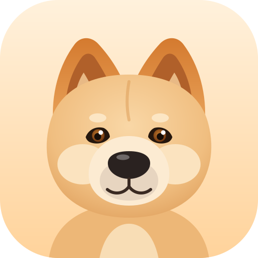
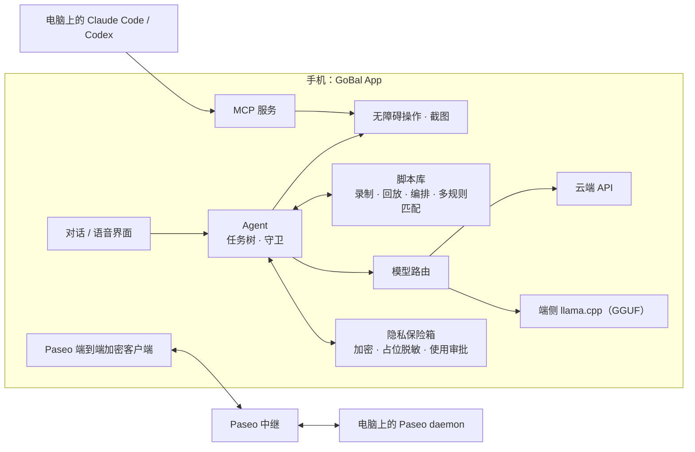

<p align="center"></p>

<h1 align="center">GoBal（狗宝）</h1>

<p align="center">
  免 root 的安卓手机 GUI Agent：说一句话，它替你在手机上把事办完。
</p>

<p align="center">
  <a href="https://github.com/4ward2/GoBal/actions/workflows/ci.yml"></a>
  <a href="LICENSE.md"></a>
  
</p>

<p align="center"><b>中文</b> · <a href="#english">English</a></p>

---

## 为什么做狗宝

狗宝想做的事和 [Meta Muse](https://about.fb.com/news/2026/09/introducing-muse) 一样：**你说一句话，它替你把事办完。** 不同的是，狗宝主打**科技平权、人文关怀**：

- **跑在你自己的手机上。** 不需要电脑、不需要 ADB 连线，也不需要把任务交给云端虚拟机；它直接操作你手机里的真实 App，包括只在国内提供的 App。
- **面向各年龄群体，尤其照顾不会用手机的人。** 中老年人、不识字的用户只要开口说话，狗宝就能替他们点按、输入、跑完流程；熟练的人也能把重复操作交给它。
- **模型由你决定。** 可以接任意云端大模型，也可以把模型下载到手机里完全离线运行。
- **私密信息不交给 AI。** 电话、地址等存在加密保险箱，Agent 只看到占位符；付款、验证码、登录始终由本人完成。
- **完全开源。** MIT 许可，代码、数据流和权限都可以审计。

## 它能做什么

**手机 Agent**
- 读懂当前界面并操作任意 App：点击、输入、滑动、返回、切换应用。
- 长任务用**树状上下文**管理：把大任务拆成子任务逐个推进，搜索型任务会记录已经看过的分支，避免原地打转或编造结果。
- 内置守卫：遇到付款下单、验证码和登录会停下来交给你本人处理；只操作你在设置里授权过的 App。

**脚本：越用越快**
- Agent 成功完成过的操作，会被**固化成脚本**；同类任务再来时直接回放，不必每一步都问模型。
- 也可以**人工录制**：在手机上演示一遍，狗宝记下每一步，之后可以回放、修改、拼接编排。
- 回放时按**多种规则匹配**目标：文字、OCR 识别结果、图像特征、屏幕签名，界面小改版也能找到对的按钮。

**模型：端侧和云端都能用**
- 云端预置 OpenAI、Anthropic、DeepSeek、Gemini、通义千问、智谱、Kimi、硅基流动、OpenRouter，也可以填任意 OpenAI 兼容接口。
- 端侧内嵌 llama.cpp，可在手机上直接下载、运行 GGUF 模型，完全离线工作。

**对话、语音与记忆**
- 手机端自带对话界面，会话本地保存，可编辑、导出、带附件。
- 通话式语音交互：本地语音识别、语音合成、回声抑制，可以像打电话一样跟狗宝说话。
- 记忆库：可以导入文档和图片（含 OCR），让 Agent 记住你的偏好和常用信息。

**隐私保险箱**
- 手机号、地址、证件号等私密信息存在加密保险箱里，Agent 只看到占位符，真实内容不会发给模型；需要填写时再经你批准。
- 支持用语音录入数字和中文数字，自动校正。

**和电脑上的 Agent 联动**
- 狗宝同时是一个 **MCP 服务**：电脑上的 Claude Code、Codex 等可以通过 MCP 直接操控这台手机。
- 实现了 [Paseo](https://github.com/getpaseo/paseo) 协议的**端到端加密客户端**：扫码配对后，在手机上就能查看和指挥电脑上的编程 Agent。
- 支持 Cloudflare Tunnel / ngrok 隧道，手机不在同一局域网也能连。

**生活小助手**
- 自动读取短信验证码并填入当前输入框。
- 自动跳过 App 的开屏广告。
- 角色卡：给狗宝换个性格和说话风格。

## 和同类产品比较

下表依据各项目 2026 年 10 月的公开资料整理，如有出入以各项目官方说明为准。

| | **狗宝 GoBal** | [Meta Muse](https://about.fb.com/news/2026/09/introducing-muse) | [Open-AutoGLM](https://github.com/zai-org/Open-AutoGLM) | [DroidRun](https://github.com/droidrun/droidrun) | [Mobile-Agent](https://github.com/X-PLUG/MobileAgent) | [UI-TARS](https://github.com/bytedance/UI-TARS) |
|---|---|---|---|---|---|---|
| 形态 | 手机 App | 云端个人智能体（App、网页、WhatsApp） | 电脑端框架 | 电脑端框架 | 研究框架 | 视觉语言模型 |
| 开源许可 | MIT | 闭源 | Apache-2.0 | MIT | MIT | Apache-2.0 |
| 在哪里执行 | 手机本机，免 root | 云端安全虚拟机里的浏览器 | 电脑经 ADB / HDC 控制手机 | 电脑经 ADB + Portal App 控制手机 | 自建部署或云手机 | 需自行部署算力 |
| 需要电脑 | 不需要 | 不需要 | 需要 | 需要（或其云服务） | 未说明 | 需要推理服务器 |
| 模型 | 9 家云端预置、任意 OpenAI 兼容接口、端侧 GGUF 离线 | Meta 自有 | AutoGLM-Phone-9B（OpenAI 兼容接口） | 多家云端，含 Ollama | GUI-Owl 系列 | UI-TARS 自身 |
| 完全离线 | 支持，模型跑在手机上（llama.cpp） | 不支持 | 需自建 GPU 服务器 | 未说明 | 需自建推理服务 | 需自建推理服务 |
| 私密信息 | 加密保险箱，Agent 只见占位符，使用需审批 | 称 Agent 看不到密码和支付信息，一次性卡号付款 | 敏感操作确认，登录和验证码人工接管 | 未说明 | 未说明 | — |
| 操作固化与复用 | 成功操作自动固化为脚本；可人工录制、回放、编排 | 未说明 | 未说明 | 可回放宏 | 未说明 | — |
| 可用地区 | 不限 | 美国 | 不限 | 不限 | 不限 | 不限 |

狗宝的定位，是把这些项目里“能办事的 Agent”直接装进每个人的手机：不依赖电脑和云端虚拟机，也不绑定某一家的模型。

## 架构一览



## 快速开始

### 安装

正式安装包会发布在 [Releases](https://github.com/4ward2/GoBal/releases)。在那之前，请按下面的步骤从源码构建。

系统要求：Android 10（API 29）及以上。

### 从源码构建

```bash
git clone --recurse-submodules https://github.com/4ward2/GoBal.git
cd GoBal
python scripts/fetch_sherpa_onnx.py   # 下载并校验固定版本的语音运行时
./gradlew assembleDebug
```

- 需要 **JDK 17** 和 Android SDK；隧道相关的原生依赖见 [CONTRIBUTING.md](CONTRIBUTING.md)。
- 中英文 OCR 数据已经包含在仓库里。所有第三方组件的来源、SHA-256 和许可证见 [THIRD_PARTY_LICENSES.md](THIRD_PARTY_LICENSES.md)。
- 无线 ADB 配对还需要 `libadbpairing.so`，用 [scripts/build-adb-pairing.sh](scripts/build-adb-pairing.sh) 配合 Android NDK 构建；生成的 JNI 库不进仓库。
- 签名请使用你自己的 keystore，模板见 `keystore.properties.example`。

### 第一次使用

1. 打开狗宝，按提示开启**无障碍服务**和**屏幕截取**权限（每项权限的用途见 [docs/PERMISSIONS.md](docs/PERMISSIONS.md)）。
2. 在设置里选择模型：填入任一云端服务的 API Key，或者下载一个端侧 GGUF 模型。
3. 在对话框里说出你的需求，比如“帮我看看今天的快递到哪了”。

### 让电脑上的 Agent 控制手机

- **MCP**：在狗宝里打开 MCP 服务，把显示的地址和令牌填进 Claude Code / Codex 的 MCP 配置。工具清单见 [docs/MCP_TOOLS.md](docs/MCP_TOOLS.md)。
- **Paseo**：在电脑上运行 Paseo，用狗宝扫描配对二维码，即可通过加密中继互联。

## 隐私与安全

- 狗宝能看到并操作你手机上的界面，请只在你信任的模型服务和设备上使用。
- 保险箱里的私密信息以加密形式保存在本机，发给模型的内容会先替换成占位符。
- 签名密钥、开发日志、聊天截图和任何个人凭据都不包含在本仓库中；请通过 App 自行配置 API Key。
- 付款下单、验证码和登录由你本人完成，狗宝不会代劳。请遵守所操作 App 的服务条款。

## 文档

- [docs/ARCHITECTURE.md](docs/ARCHITECTURE.md)：MCP 服务端的整体结构
- [docs/MCP_TOOLS.md](docs/MCP_TOOLS.md)：MCP 工具清单
- [docs/PERMISSIONS.md](docs/PERMISSIONS.md)：权限说明

## 项目状态

狗宝处于早期开发阶段（0.1），接口和界面仍会调整。欢迎在 [Issues](https://github.com/4ward2/GoBal/issues) 反馈问题和想法。

## 来源与许可

狗宝以 MIT 许可发布，见 [LICENSE.md](LICENSE.md)。

狗宝的 MCP 服务端和无障碍控制底层源自 Daniele Salvatore Albano 的 [Android Remote Control MCP](https://github.com/danielealbano/android-remote-control-mcp)（MIT），其版权声明保留在 LICENSE.md 中。在此基础上，狗宝新增了手机端对话与 Agent、任务树与脚本系统、端侧模型、语音、隐私保险箱、Paseo 加密互联等功能。其余第三方组件见 [THIRD_PARTY_LICENSES.md](THIRD_PARTY_LICENSES.md)。

本软件按“现状”提供，不附带任何担保。使用者需自行确保使用方式符合法律法规和相关平台的规定。

---

<a id="english"></a>

## English

**GoBal (狗宝)** aims at what [Meta Muse](https://about.fb.com/news/2026/09/introducing-muse) does, getting things done for you from one sentence, but it runs on your own phone, is open source (MIT), works with any model including fully offline ones, and is designed first for people who struggle with smartphones. It reads the accessibility tree and taps, types and swipes like a person in any real app, with no PC, ADB or cloud VM required.

- **Agent:** long tasks are managed as a task tree; search-style tasks remember explored branches so the agent neither loops nor invents results. Guards hand payments, captchas and logins back to you, and only apps you have allowed are touched.
- **Scripts:** actions the agent completed are turned into replayable scripts. You can also record a demonstration yourself, then replay, edit and compose scripts. Targets are matched by text, OCR, image features and screen signatures.
- **Models:** presets for OpenAI, Anthropic, DeepSeek, Gemini, Qwen, Zhipu, Kimi, SiliconFlow and OpenRouter, any OpenAI-compatible endpoint, or fully offline GGUF models through embedded llama.cpp.
- **Voice and memory:** a call-style voice mode with on-device STT, TTS and echo suppression; a memory library fed by documents and OCR.
- **Privacy vault:** personal data is stored encrypted and shown to the model only as placeholders; filling it in needs your approval.
- **Desktop agents:** GoBal is also an MCP server for Claude Code / Codex, and an end-to-end-encrypted [Paseo](https://github.com/getpaseo/paseo) client.

Build with JDK 17: `git clone --recurse-submodules https://github.com/4ward2/GoBal.git`, run `python scripts/fetch_sherpa_onnx.py`, then `./gradlew assembleDebug`. Requires Android 10+.

GoBal is MIT-licensed. Its MCP server and accessibility foundation are derived from [Android Remote Control MCP](https://github.com/danielealbano/android-remote-control-mcp) by Daniele Salvatore Albano (MIT); that copyright notice is kept in LICENSE.md.
